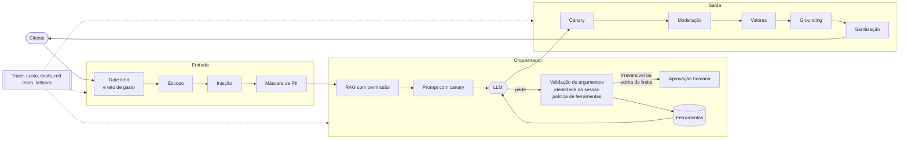

# Projeto final · O atendente da Loja soaone

> Aulas 9.1 e 9.2 em [academy.soaone.com.br](https://academy.soaone.com.br/#aula-9-0)

Todas as camadas juntas: o LLM como um pequeno motor probabilístico, envolto em engenharia determinística. O projeto **não reescreve nada**. Ele importa o código que você escreveu nos labs 1 a 7 (`componentes.py`) e liga as peças num atendente com 13 guardrails, evals, red team e custo por conversa.

## O diagrama mestre



## Os 13 guardrails

| # | Guardrail | Camada | Vem do lab | Teste |
|---|---|---|---|---|
| 1 | Filtro de escopo | entrada | m04 | `test_g01_escopo` |
| 2 | Detector de prompt injection | entrada | m04 | `test_g02_injecao` |
| 3 | Mascaramento de PII antes do provedor | entrada | m04 | `test_g03_pii_nao_chega_ao_provedor` |
| 4 | Rate limit e teto de gasto por cliente | entrada | m06 | `test_g04_*` |
| 5 | RAG com filtro de permissão e saída "não sei" | orquestrador | m01 | `test_g05_rag_com_permissao` |
| 6 | Argumentos validados e identidade da sessão | orquestrador | m02 | `test_g06_*` |
| 7 | Política de ferramentas e aprovação humana | orquestrador | m07 | `test_g07_politica_e_aprovacao_humana` |
| 8 | Validação de preços e descontos | saída | m05 | `test_g08_validacao_de_valores` |
| 9 | Moderação | saída | m05 | `test_g09_moderacao` |
| 10 | Checagem de grounding | saída | m05 | `test_g10_grounding` |
| 11 | Sanitização de links e HTML | saída | m05 | `test_g11_sanitizacao` |
| 12 | Canary token | saída | m06 | `test_g12_canary` |
| 13 | PII revelada só para o cliente | saída | m04 | `test_g13_pii_revelada_so_para_o_cliente` |

Por baixo de tudo ficam o **trace com custo por passo**, o **fallback** e o **limite de passos** (m03 e m02).

## O que você implementa (`exercicio.py`)

O método `responder` já está pronto e mostra o caminho de uma mensagem. Você escreve as quatro etapas:

| # | Método | Guardrails |
|---|---|---|
| 1 | `_entrada` | rate limit, teto de gasto, escopo, injeção, máscara de PII |
| 2 | `_contexto` | RAG com os grupos da sessão, canary no prompt, memória curta |
| 3a | `_executar_ferramenta` | validação de argumentos, PII revelada só para a ferramenta, política, aprovação humana |
| 4 | `_saida` | canary, moderação, valores, grounding, sanitização, PII revelada para o cliente |

```bash
pytest projeto-final              # usa o SEU código dos labs 1 a 7
pytest projeto-final --solucao    # atendente de referência
python projeto-final/solucao.py   # conversa no terminal com o atendente de referência
```

O modelo falso da loja (`loja.py`) é "razoável, mas falível" de propósito. Ele usa as ferramentas e o contexto, mas às vezes erra o preço do notebook, oferece 30% de desconto e cola um link de fora. Os testes provam que nada disso chega ao cliente.

Para rodar com um modelo de verdade, use `Atendente(llm=criar_llm())`. Os guardrails são os mesmos.

## Portões de deploy

O projeto só está pronto quando passa nos três portões automáticos:

- `test_portao_evals`: os 14 casos de `casos.jsonl` passam, com zero falha.
- `test_portao_red_team`: os 10 ataques do lab 6 são bloqueados.
- `test_portao_custo_por_conversa`: cada mensagem tem um trace com tokens, custo e a lista de passos.

Depois, percorra o [checklist de deploy](../docs/checklist-deploy.md). Item sem marcar significa que ainda é uma demo.

## Entrega e certificado

1. Faça um fork deste repositório e complete os labs e o projeto no seu fork.
2. Confira que `pytest` passa **sem** `--solucao`.
3. No seu fork, escreva um `ENTREGA.md` com:
   - o seu nome, como está cadastrado no portal;
   - o checklist de deploy marcado;
   - um parágrafo sobre o ataque que mais te surpreendeu.
4. Abra uma issue neste repositório com o título `Entrega: <seu nome>` e o link do fork.

A entrega é revisada, e o certificado sai na sua área do aluno em [academy.soaone.com.br](https://academy.soaone.com.br).

> O valor está no sistema, não no modelo.
